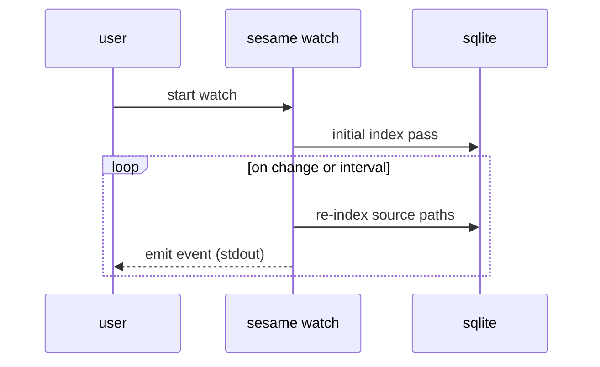

# CLI usage

## Commands

```bash
sesame index
sesame index --full
sesame search [query] [options]
sesame skills [options]
sesame status
sesame watch
sesame watch --interval <seconds>
sesame completion <bash|zsh|fish|powershell>
sesame help [command|topic]
```

All commands use the same local SQLite database: `<data-dir>/index.sqlite`. By default, the data directory is `~/.local/share/sesame` on macOS/Linux. You can override it with `SESAME_DATA_DIR`, or through the XDG variables used by `getXDGPaths()`.

Configuration lives at `<config-dir>/config.jsonc`, normally `~/.config/sesame/config.jsonc`. If it does not exist, Sesame creates:

```json
{
  "piSessionPaths": ["~/.pi/agent/sessions"]
}
```

## Global options

Global flags work before or after the command: `sesame -o json search x` and `sesame search x -o json` are the same.

- `-o, --output human|json`: output mode. `-j` / `--json` is an alias for `--output json`.
- `--pretty` / `--compact`: force indented or single-line JSON. By default JSON is indented on a terminal and single-line when piped.
- `-q, --quiet`: suppress the CLI's progress messages.
- `--no-color`: disable color. `NO_COLOR` and `TERM=dumb` also disable it, and color is off when stdout is not a terminal.
- `--debug`: print the resolved data directory, database, and config paths to stderr.
- `-h, --help`: help for the CLI or a command (`sesame search --help`). `sesame help <command>` works too.
- `-v, --version`: print the CLI version.

Help topics: `sesame help config | json | exit-codes | completion | agent-guide`.

## Streams

stdout carries results only. Errors, warnings, hints, progress, and debug output go to stderr.

Errors print as `CODE: message`. With JSON output, they print to stderr as:

```json
{"error":{"code":"INVALID_DATE","message":"invalid value for --after: \"yesterday\" (use 7d, 2w, 1m, or YYYY-MM-DD)"}}
```

Error codes include `UNKNOWN_COMMAND`, `INVALID_INPUT`, `MISSING_INPUT`, `INVALID_DATE`, `USAGE_ERROR`, `INDEX_LOCKED`, `CONFIG_ERROR`, and `SESAME_ERROR` (anything else).

## Exit codes

| Code | Meaning |
| --- | --- |
| 0 | Success |
| 1 | Runtime failure (database, config, index lock held) |
| 2 | Usage error (unknown command or flag, missing or invalid value) |
| 3 | `sesame index` finished, but some session files failed to index |
| 130 | Interrupted |

## Shell completion

```bash
sesame completion zsh > "${fpath[1]}/_sesame"
sesame completion bash > ~/.local/share/bash-completion/completions/sesame
sesame completion fish > ~/.config/fish/completions/sesame.fish
```

The Nix package installs the bash, zsh, and fish scripts automatically. The same scripts are committed in `completions/`.

Supported shells: `bash`, `zsh`, `fish`, `powershell`. The scripts call `sesame complete -- <args>`. `--skill` completes skill names from the local index, `--arg` completes `tool:key=` prefixes, and `--actor` and `--output` complete their allowed values.

## `sesame index`

Builds or updates the local index from configured Pi session paths.

- default: incremental, using each session file's mtime
- `--full`: drops Sesame tables/triggers/indexes, recreates the schema, and indexes again
- indexes `.jsonl` files directly under each configured root and one directory below it, matching Pi's encoded-cwd session layout
- takes an index lock so concurrent index/watch runs do not write at the same time
- updates `metadata.last_sync_at` only when the run has no errors and adds or updates at least one session
- prints progress to stderr and a summary (added, updated, skipped, errors) to stdout
- exits 3 when some session files failed to index

JSON output (`-o json`):

```json
{
  "full": false,
  "sources": [
    { "path": "/Users/me/.pi/agent/sessions", "added": 1, "updated": 0, "skipped": 42, "errors": 0 }
  ],
  "totals": { "added": 1, "updated": 0, "skipped": 42, "errors": 0 }
}
```

Examples:

```bash
sesame index
sesame index --full
```

## `sesame search`

Searches indexed chunks with SQLite FTS5 + BM25, then returns the best matching chunk per session.

Usage:

```bash
sesame search [query] [options]
```

Options:

- `--cwd <path>`: filter sessions by `cwd` prefix
- `--after <date>`: filter by `modified_at >= date`
- `--before <date>`: filter by `modified_at <= date`
- `--limit <n>`: max results (default: 10)
- `--tools`: search only assistant tool-call chunks
- `--tool <name>`: search a specific tool name
- `--path <file>`: restrict matches to tool-call chunks whose formatted content mentions a path
- `--skill <text>`: sessions that used a skill. An exact name match (case-insensitive) filters to that skill; otherwise the text is resolved fuzzy against the skill catalog (name + description) and sessions using any matched skill are returned. An unmatched query returns nothing.
- `--skill-path <substring>`: only sessions that used a skill whose `SKILL.md` path contains the substring; combining it with `--skill` requires both to match the same skill
- `--arg <tool:key=value>`: only sessions where `tool` was called with parameter `key` containing `value` (repeatable, AND across filters; validation fails loudly for tools/keys outside the allowlist: `bash/powershell:command`, `read/write/edit:path`, `find/grep:pattern,path`, `ls:path`, `find_sessions:query,cwd`, `list_sessions:cwd`, `read_session:goal`, `read_url:url`, `synthetic_web_search:query`, `process:action,name`)
- `--via <name>`: only tool calls that ran nested inside `<name>` (e.g. `codemode`)
- `--exclude <id>`: exclude a session id; repeatable

Date formats:

- relative: `7d`, `2w`, `1m`
- absolute: `YYYY-MM-DD` or another ISO-like date string beginning with `YYYY-MM-DD`

Notes:

- Query tokens are escaped and quoted before FTS matching, so punctuation is treated as search text rather than FTS syntax.
- CLI scores are display-normalized. Ranking still comes from SQLite FTS5 BM25, where lower raw scores are better.
- Multiple query terms first require all terms. If filters leave no all-term results, Sesame retries with any-term matching and reports the mode in `matchMode`.
- Omit the query, pass an empty query, or use `"*"` to browse sessions by `modified_at DESC`.
- The query is one argument. Quote multi-word queries: `sesame search a b` is a usage error.
- When nothing matches and the index is empty, a hint to run `sesame index` is printed to stderr.
- `status` filtering exists in the library API, not as a CLI flag.

Special query:

```bash
sesame search "*" --limit 20
```

`"*"` bypasses FTS and lists sessions by `modified_at DESC`, still honoring filters. With `--tools` or `--tool`, it joins chunks so tool filters still apply.

Examples:

```bash
sesame search "nix infra simplify"
sesame search "publish workflow" --after 2w --limit 5
sesame search "package.json exports" --tools --tool write
sesame search --cwd /Users/me/code --exclude abc --exclude def
sesame search "deploy" -o json
sesame search "*" --skill vitest
sesame search "flaky test" --skill-path /skill-library/
```

JSON output has this shape:

```json
{
  "query": "deploy",
  "resultCount": 1,
  "results": [
    {
      "sessionId": "...",
      "source": "pi",
      "path": ".../session.jsonl",
      "cwd": "/Users/me/code/project",
      "name": "Session name",
      "score": 0.42,
      "created": "2026-05-08T12:00:00.000Z",
      "modified": "2026-05-08T12:00:00.000Z",
      "matchedSnippet": "...",
      "matchMode": "all",
      "matchedType": "message",
      "matchedEntryId": "...",
      "matchedAt": "2026-05-08T12:00:00.000Z",
      "skills": ["vitest"]
    }
  ]
}
```

## `sesame skills`

Lists skills used across indexed sessions, grouped by skill name and ordered by session count. Useful for finding the exact name to pass to `sesame search --skill`.

Options:

- `--cwd <path>`: only count sessions whose `cwd` starts with this path
- `--after <date>` / `--before <date>`: same date handling as `search`
- `--actor <kind>`: `user` (skill injected by a user action: `/skill:name` slash command or `?name` autocomplete) or `agent` (`SKILL.md` read via a tool)
- `--limit <n>`: max rows (default: 100, capped at 1000)

Examples:

```bash
sesame skills
sesame skills --after 1m --actor user
sesame skills --cwd /Users/me/code -o json
```

JSON output:

```json
{
  "skillCount": 1,
  "skills": [
    {
      "name": "vitest",
      "sessionCount": 9,
      "actors": ["agent", "user"],
      "details": [
        { "actor": "agent", "details": [null] },
        { "actor": "user", "details": ["autocomplete", "slash"] }
      ],
      "paths": ["/Users/me/skills/vitest/SKILL.md"]
    }
  ]
}
```

## `sesame status`

Shows index stats:

- session count
- chunk count
- database size
- last successful sync timestamp
- database location

JSON output (`-o json`):

```json
{
  "sessionCount": 120,
  "chunkCount": 48210,
  "dbSizeBytes": 8388608,
  "lastSyncAt": "2026-05-08T12:00:00.000Z",
  "databasePath": "/Users/me/.local/share/sesame/index.sqlite"
}
```

## `sesame watch`

Runs one initial index pass, then keeps re-indexing configured paths.

Modes:

- default: `fs.watch(..., { recursive: true })` with a 500 ms debounce per source path
- `--interval <seconds>`: polling mode, re-indexing all configured sources on that interval

Outputs:

- stderr: timestamped logs
- stdout: one event per indexed source or file

By default each event is a text line:

```text
2026-05-08T12:00:00.000Z /Users/me/.pi/agent/sessions added=1 updated=0 skipped=42 errors=0
```

With `-o json`, each event is one JSON object per line (always single-line), and failures are emitted as `{"timestamp", "path", "error"}` events:

```json
{"timestamp":"2026-05-08T12:00:00.000Z","path":"/Users/me/.pi/agent/sessions","added":1,"updated":0,"skipped":42,"errors":0}
```

`SIGINT` and `SIGTERM` stop the watcher cleanly with exit code 0.


